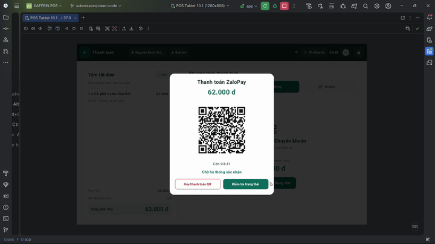

# KAFFEIN

Hệ thống bán hàng và quản lý nguyên liệu cho một chuỗi cà phê có nhiều chi nhánh. Dự án gồm Android POS, Web Admin và Backend API. Mỗi chi nhánh có một POS hoạt động; Owner quản lý toàn chuỗi, Store Manager làm việc trong phạm vi chi nhánh được cấp.

POS đọc dữ liệu từ Room, lưu thao tác vào outbox và đồng bộ với máy chủ bằng mã thao tác ổn định. Bán tiền mặt có thể hoàn tất khi mất mạng nếu dữ liệu và phiên làm việc đã sẵn sàng. Thanh toán QR ZaloPay/MoMo cần xác nhận trực tuyến từ máy chủ. Hóa đơn đã thanh toán được giữ nguyên; hoàn tiền không thuộc phạm vi triển khai.

## Video Demo Hệ thống

https://github.com/user-attachments/assets/c371b05e-12b4-4526-bce0-0647f7449965

<p align="center">
  <a href="https://drive.google.com/drive/folders/1wdwwHIi8vouFsOt2kym_0qYmnL6fI6R4?usp=drive_link" target="_blank">
    
  </a>
  <br>
  <em>(Hình xem trước trích từ video demo — nhấp vào ảnh để xem bản đầy đủ trên Google Drive)</em>
</p>

Video quay lại toàn bộ kịch bản vận hành thực tế của hệ thống KAFFEIN (thời lượng **22:24**):
- **Web Admin:** Quản trị chuỗi, danh mục thực đơn, nguyên vật liệu kho, quản lý nhân sự & phân quyền, báo cáo số liệu toàn chuỗi.
- **Android POS:** Quy trình bán hàng tại quầy (mở ca/phiên quỹ, tạo order món, thanh toán tiền mặt offline, thanh toán trực tuyến qua mã QR MoMo/ZaloPay Sandbox và kết ca quỹ).
- **Khả năng chịu lỗi & đồng bộ:** Bán hàng ngoại tuyến khi mất mạng (Room Outbox) và tự động đồng bộ khi có kết nối trở lại.

> - **Xem video trực tuyến (22:24):** [Google Drive Folder](https://drive.google.com/drive/folders/1wdwwHIi8vouFsOt2kym_0qYmnL6fI6R4?usp=drive_link)
> - **Tệp video nội bộ:** [`thesis/kaffein-system-demo.mp4`](thesis/kaffein-system-demo.mp4) (Gốc ~1.4 GB) &bull; [`thesis/kaffein-system-demo-compressed.mp4`](thesis/kaffein-system-demo-compressed.mp4) (Bản nén 46 MB)

## Thành phần

| Thư mục | Nội dung |
| --- | --- |
| [apps/api](apps/api/README.md) | NestJS, PostgreSQL, Prisma, xác thực, bán hàng, kho, thanh toán và đồng bộ |
| [apps/web](apps/web/README.md) | React/TypeScript cho quản trị chi nhánh, nhân sự, thực đơn, kho và báo cáo |
| [apps/pos](apps/pos/README.md) | Kotlin, Jetpack Compose, Room và WorkManager |
| [packages/contracts](packages/contracts/) | Các kiểu hợp đồng dùng chung |
| [infra](infra/README.md) | AWS CDK: ECS Fargate, ALB, RDS, Secrets Manager và giám sát |
| [scripts](scripts/) | Kiểm thử tích hợp, kiểm tra container và phát hành ứng dụng |

## Yêu cầu môi trường

- Node.js 24 và npm; phiên bản được ghi trong [.node-version](.node-version).
- Docker Engine chạy Linux containers và Docker Compose để chạy PostgreSQL 17.
- Android Studio, JDK 21, Android SDK Platform 36.1, Build Tools 36.0.0 và Platform Tools để build POS. Thiết bị chạy Android API 26 trở lên.

Các lệnh dưới đây dùng PowerShell tại thư mục gốc. Trên Linux/macOS, dùng `npm` thay `npm.cmd` và lệnh Gradle tương ứng trong hướng dẫn POS.

## Khởi tạo môi trường local

Chỉ thực hiện phần khởi tạo trên cơ sở dữ liệu local mới. Nếu đã có `.env`, kiểm tra cấu hình hiện tại trước khi sao chép.

```powershell
Copy-Item .env.example .env
npm.cmd ci
docker compose up -d --wait postgres
npm.cmd run db:generate -w api
npm.cmd run db:deploy -w api
npm.cmd run db:seed -w api
```

Trước khi khởi động API, sửa `JWT_ACCESS_SECRET` trong `.env` thành chuỗi riêng đủ dài. Nếu đổi tài khoản hoặc cổng PostgreSQL, cập nhật đồng thời các biến `POSTGRES_*` và `DATABASE_URL`. Cấu hình mặc định dùng database `coffee_pos`, cổng máy chủ `55432`. API đọc biến `PORT` và mặc định lắng nghe tại cổng `3000`.

Lệnh `db:seed` gọi [seed-master-catalog.ts](apps/api/prisma/seed-master-catalog.ts) theo [prisma.config.ts](apps/api/prisma.config.ts). Seed tạo hai chi nhánh, nhân sự và thực đơn mẫu. Chạy lại seed có thể ghi đè mật khẩu demo và số dư kho; không dùng để sửa dữ liệu đang vận hành.

| Tài khoản local mới | Thông tin thử nghiệm |
| --- | --- |
| `owner@kaffein.vn` | Mật khẩu demo `123456`, quyền Owner |
| `manager.q1@kaffein.vn` | Mật khẩu demo `123456`, quản lý chi nhánh Quận 1 |
| Thu ngân `1000702` | PIN demo `1234`, chi nhánh Quận 1 |

Đây là dữ liệu mẫu của seed local. Tài khoản triển khai sử dụng mật khẩu riêng được cấp qua môi trường/Secrets Manager. Mã Owner là `1000001`; nhân sự còn lại bắt đầu từ `1000701` trên database mới. Seed chưa tạo tài khoản đăng nhập Web cho manager Quận 2. Owner có thể đặt PIN cho nhân sự qua Web trước khi thử các nghiệp vụ POS cần PIN tương ứng.

## Chạy API và Web

Mở hai terminal riêng tại thư mục gốc:

```powershell
npm.cmd run dev:api
```

```powershell
npm.cmd run dev:web
```

- Web Admin: <http://localhost:5173>.
- API: <http://localhost:3000/api/v1>.
- Kiểm tra API và kết nối database: <http://localhost:3000/health>.
- Tài liệu OpenAPI: <http://localhost:3000/api/docs>.

Web mặc định gọi API local. Có thể đặt `VITE_API_BASE_URL` trong môi trường chạy Web hoặc `apps/web/.env.local` khi dùng địa chỉ khác. Không đặt mật khẩu, PIN hay khóa thanh toán trong biến `VITE_*`.

## Chạy Android POS local

Mở thư mục `apps/pos` bằng Android Studio, cài SDK và cấu hình Gradle JDK 21. Từ terminal:

```powershell
cd apps/pos
.\gradlew.bat :app:assembleDebug -PposEnvironment=local
.\gradlew.bat :app:installDebug -PposEnvironment=local
```

Máy ảo Android gọi API trên máy tính qua `http://10.0.2.2:3000/api/v1/`. Bản build mặc định không có cờ `local` dùng API AWS và package riêng. Xem [hướng dẫn POS](apps/pos/README.md) khi chạy trên thiết bị thật.

Đăng nhập Web bằng Owner, tạo mã kích hoạt cho chi nhánh rồi nhập mã trên POS. Chấm công, đăng nhập thu ngân và mở phiên quỹ là các bước riêng. Không xóa dữ liệu hoặc đổi backend của một POS đang giữ giao dịch chưa đồng bộ.

## Thanh toán Sandbox

Để thử thanh toán QR, cấp thông tin Sandbox của ZaloPay/MoMo qua các biến trong [.env.example](.env.example). API truy vấn trạng thái provider để xác nhận thanh toán; callback HTTPS là một đường tiếp nhận bổ sung. Không có khóa Sandbox thì vẫn có thể chạy luồng tiền mặt và các bài kiểm thử dùng provider giả lập.

## Kiểm tra mã nguồn

```powershell
npm.cmd run build -w api
npm.cmd run build -w web
npm.cmd run test -w api -- --runInBand
npm.cmd run test -w web
npm.cmd run test -w @kaffein/infra
node --test scripts/aws-release.test.mjs scripts/test-container-bootstrap.mjs scripts/test-prisma-cloud-config.mjs
```

API E2E cần database local riêng có tên kết thúc bằng `_e2e` và xác nhận ghi dữ liệu trong shell. Xem [hướng dẫn API](apps/api/README.md); không chạy E2E trên `coffee_pos` hoặc RDS. Kiểm thử Android được hướng dẫn trong [apps/pos](apps/pos/README.md).

Không đưa `.env`, database, khóa AWS, khóa thanh toán, khóa ký APK hoặc thư mục build vào gói mã nguồn. Hướng dẫn hạ tầng và phát hành nằm tại [infra/README.md](infra/README.md).
